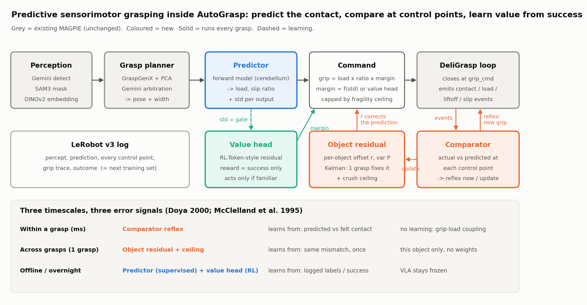
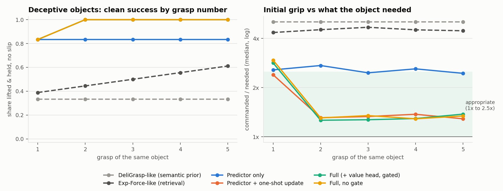
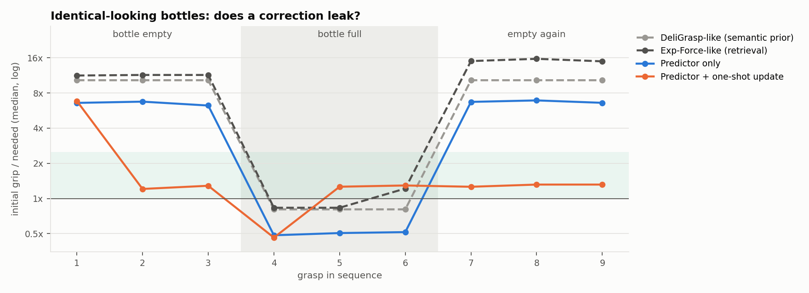
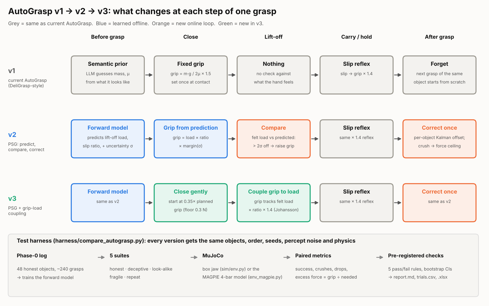

# Predictive Sensorimotor Grasping (PSG) for MAGPIE AutoGrasp

**Project page:** https://acwarob.github.io/predictive-sensorimotor-grasping/ · **Technical note:** [docs/assets/PSG_System_Architecture.pdf](docs/assets/PSG_System_Architecture.pdf) · **Related work:** [RESEARCH_2026-10-22.md](RESEARCH_2026-10-22.md)

Predict what the grasp should feel like, compare at contact events, fix the prediction in one grasp, and learn the safety margin from success. Drop-in beside DeliGrasp; the VLA, GraspGenX and DeliGrasp stay as they are.



## What's in here

```
psg/                    the method (numpy only, no ROS, no torch)
  types.py              Percept, Prediction, ControlPoint, GraspLog
  predictor.py          forward model: embedding + grasp -> log load, log slip-ratio, + std   (cerebellum)
  residual.py           per-object Kalman residual + crush ceiling                            (fast system)
  comparator.py         control-point callback: reflex now / one-shot update                  (tactile loop)
  value_head.py         margin from success only, LinUCB now, RL-Token later                  (basal ganglia)
  agent.py              wires them; modes: predictor | predictor+update | full | full-nogate
  adapters/autograsp.py the 4 protocols to implement against MAGPIE + grasp_once()
sim/                    MuJoCo comparison harness
  env.py                floating parallel gripper, force-controlled fingers, lift + hold, crush limit
  objects.py            honest train/held-out objects + 6 deceptive ones
  baselines.py          DeliGrasp-like (semantic prior) and Exp-Force-like (retrieval)
  run_experiments.py    Phase 0 collect -> fit -> Exp A/B/C + ablation -> results/
  plots.py, draw_architecture.py
tests/test_core.py      3 fast tests (fit, one-shot gain, no leak)
results/                CSVs + figures from the 3-seed run below
```

## The architecture in one paragraph per part

**Predictor (trained offline, supervised).** Input: DINOv2 embedding of the SAM3 crop + grasp descriptor from GraspGenX. Output, in log space: the vertical load the fingers will carry at lift-off, and the grip/load ratio at which it slips (≈ 1/2μ), each with a standard deviation. Labels come free from logs: lift-off load from wrist F/T or motor current, slip ratio from a slow grip-release probe after a successful hold. Bootstrap ensemble of ridge regressors on random features, so the std grows off-distribution.

**Command.** `grip = load × ratio × margin`, where margin rises with predicted std (humans grip harder when unsure), or comes from the value head when the gate says the object is familiar. Capped by a learned fragility ceiling if this object was ever crushed.

**Comparator (every control tick).** Before lift-off: if load climbs past predicted + 2σ, couple grip to load (`grip = load × ratio × 1.3`), the Johansson-Westling grip-load coupling. At lift-off: z-score the actual load; past 1σ, one Kalman update to this object's residual. On slip: boost grip ×1.4 and raise the ratio residual to at least what it slipped at.

**Object residual (online, per object).** One offset per predicted quantity, initial variance = predictor's own variance, so when the predictor was unsure the gain is ≈1: one grasp fixes the next prediction. Keyed by instance, never shared, never touches weights. Persist with `save_residuals()`.

**Value head (offline warm-start + online).** Picks a margin from {1.05, 1.2, 1.4, 1.7, 2.1} given [predicted load, ratio, total std]. Reward = success − small force cost. Prediction error is never the reward; it only gates whether the value head acts.

## How to drop it into AutoGrasp

1. Implement the four protocols in `psg/adapters/autograsp.py`:
   `Perception.embedding` (DINOv2 CLS on the SAM3 crop), `Perception.instance_id` (tracker or scene slot), `GraspPlanner.best_grasp` (GraspGenX + Gemini arbitration → pose, descriptor), and `ForceController.execute` (wrap DeliGrasp: start at `grip_N`, emit `contact / load / liftoff / slip`, apply any returned grip). The event contract is in the docstring.
2. **Phase 0:** replay LeRobot logs to extract `(embedding, grasp, lift-off load)` rows. Run ~10 objects × 5 grasps with the slip probe to get ratio labels. Target ≥150 rows.
3. **Phase 1:** `ForwardModel().fit(X, Y)`; check calibration: about 68% of held-out errors should fall within 1 predicted std.
4. **Phase 2:** run `grasp_once()` with `mode="predictor+update"`; reproduce Exp A on 2 real deceptive pairs (big hollow box vs small dense block; identical bottles, one full).
5. **Phase 3:** `mode="full"`, swap `ValueHead` for an RL-Token actor-critic with the same `choose/update` interface.

`load_N` on the robot: wrist F/T z minus gripper weight, or a motor-current proxy if there's no F/T. Without a load signal the lift-off control point and the load reflex don't exist, so check this first with your partner (it's their force loop).

## Getting MuJoCo running (Mac)

```bash
# 1. env
python3 -m venv ~/venvs/psg && source ~/venvs/psg/bin/activate
pip install mujoco numpy matplotlib pytest        # MuJoCo 3.x wheels ship for Apple Silicon; no license, no extra install

# 2. sanity check
python -c "import mujoco; print(mujoco.__version__)"
cd predictive-sensorimotor-grasping
python -m sim.env                                  # prints success / crush per grip force on a test box
python -m pytest tests -q

# 3. full comparison (about 7 min for 3 seeds; writes results/)
python -m sim.run_experiments --seeds 3

# 4. watch a grasp (macOS needs mjpython for the passive viewer)
mjpython -c "
import mujoco, mujoco.viewer, time
from sim.env import _build, PhysObject
m, d = _build(PhysObject('box', (0.03,0.03,0.04), 0.4, 0.5, 40))
with mujoco.viewer.launch_passive(m, d) as v:
    for k in range(3000):
        d.ctrl[1] = d.ctrl[2] = 8.0
        d.ctrl[0] = 0.0 if k < 300 else min(0.1, (k-300)/1000*0.1)
        mujoco.mj_step(m, d); v.sync(); time.sleep(0.001)
"
```

To move to your real arm in sim later: `git clone https://github.com/google-deepmind/mujoco_menagerie`, load the arm + gripper XML (Franka, UR5e + Robotiq 2F-85 are there), and replace `sim/env.py`'s floating hand while keeping the same callback events. The method code doesn't change.

## Results so far (MuJoCo, 3 seeds; 30 unseen + 30 deceptive grasps per seed)

| Method | Deceptive: lifted & held | Unseen: force error (N) | Unseen: initial grip appropriate |
| --- | --- | --- | --- |
| DeliGrasp-like (semantic prior) | 39% | 1.93 | 92% |
| Exp-Force-like (retrieval) | 51% | 3.07 | 44% |
| Predictor only | 83% | 0.99 | 97% |
| Predictor + one-shot update | 97% | 0.93 | 97% |
| Full (+ value head, gated) | 97% | 0.70 | 91% |
| Full, no gate | 97% | 0.78 | 90% |




What this does and doesn't show, honestly:

- **Supported:** the one-shot update fixes deceptive objects by the second grasp (grip ratio drops from ~2.5× to ~1.3× of need), and it doesn't leak: after the full bottle, retrieval over-grips the identical empty bottle at ~15× need, ours stays ~1.3×.
- **Supported:** the prediction-triggered load reflex is why "predictor only" already beats both baselines on deceptive objects (83% vs 39–51%). It lifts heavy-looking-light objects on the first try because it notices the load running past prediction.
- **Not supported yet:** the value head and the gate add nothing measurable here (97% either way). The sim has one knob (grip) and a simple failure model, so there's little margin policy to learn. Either show it on the robot with fragile + slippery objects, or drop claim 2.
- **Caveats:** sim, not hardware. Objects are boxes, the "embedding" is a random projection of size + material, and the bottle test assumes the robot knows which bottle is which (tracker / scene slot). With truly indistinguishable objects and no tracking, a human also falls back on "the last one I lifted"; that's a fair experiment to add.

## v1 vs v2 vs v3 harness (Nov 3, 5 seeds, paired)

`python -m harness.compare_autograsp --seeds 5`. Plan in [harness/TEST_PLAN.md](harness/TEST_PLAN.md); full report in [harness/out/report.md](harness/out/report.md).

| Suite | v1 DeliGrasp-style | v2 PSG | v3 PSG + coupling |
|---|---|---|---|
| Honest unseen (success) | 100% | 100% | 100% |
| Deceptive weight | 40% | 97% | 99% |
| Look-alike leak | 80% | 100% | 100% |
| Fragile, looks sturdy | 33% (30 crushes) | 82% (8) | **100% (0)** |
| Same object ×5 | 100% | 100% | 100% |
| Peak grip ÷ need (median, deceptive) | 5.3× | 1.4× | 1.5× |

v2 and v3 pass all five pre-registered checks against v1.



### Same harness on the real MAGPIE gripper model

`python -m harness.compare_autograsp --seeds 5 --gripper magpie --jobs 2 --out harness/out_magpie` swaps the simple jaw for the MAGPIE MuJoCo model from HAMS (`CL_Assets/mujoco_assets/magpie_gripper.xml` + STL meshes, copied to `sim/assets/magpie/`): two 4-bar linkages closed by `connect` equalities, 4 pads per finger. Grip is applied as crank torque, τ = grip × J(θ), with J measured from the linkage (`sim/env_magpie.py`), the way the Dynamixel current limit sets force on hardware. Both the Phase-0 training log and the test grasps use MAGPIE. Report: [harness/out_magpie/report.md](harness/out_magpie/report.md).

| Suite | v1 | v2 PSG | v3 PSG + coupling |
|---|---|---|---|
| Honest unseen | 99% | 100% | 100% |
| Deceptive weight | 50% | 97% | 99% |
| Look-alike leak | 100% | 100% | 100% |
| Fragile, looks sturdy | 33% (30 crushes) | 84% (7) | **100% (0)** |
| Same object ×5 | 100% | 100% | 100% |

v2 and v3 again pass all five checks against v1. The result does not depend on the gripper geometry.

### Ablation: which part of v3 does the work? (MAGPIE, 5 seeds)

`HARNESS_SYSTEMS=v1_deligrasp,a1_v1_plus_coupling,a2_predict_only,a3_predict_couple,a4_predict_memory,v4_no_value_head,v3_psg_couple python -m harness.compare_autograsp --seeds 5 --gripper magpie --jobs 2 --out harness/out_ablation_magpie`

| Version | Coupling | Memory | Deceptive | Fragile (crushes) | Grip ÷ need, deceptive |
|---|---|---|---|---|---|
| v1 (looks-based prior) | no | no | 50% | 33% (30) | 5.4× |
| v1 + coupling | yes | no | 83% | 67% (15) | 2.5× |
| Learned prediction only | no | no | 83% | 49% (23) | 3.2× |
| Prediction + coupling | yes | no | 98% | 98% (1) | 1.6× |
| Prediction + memory | no | yes | 97% | 82% (8) | 1.25× |
| **v4 = v3 without value head** | yes | yes | **99%** | **100% (0)** | 1.3× |
| v3 | yes | yes | 99% | 100% (0) | 1.3× |

Coupling stops first-grasp drops and crushes but needs a roughly right prediction (on v1's prior it still crushes 15). Memory brings force down to ~1.3× from grasp 2. Both are needed; the value head adds nothing (v4 = v3), so v4 is the robot version.

**Videos:** `harness/out_magpie/psg_inside_one_grasp.mp4` (v1 vs v3 with live grip / needed-grip traces) and `harness/out_magpie/psg_v1_v2_v3_magpie.mp4` (MAGPIE) and `harness/out/psg_v1_v2_v3.mp4` (box jaw): v1 / v2 / v3 side by side on real harness trials, replayed exactly (`MUJOCO_GL=osmesa python -m harness.make_video [--magpie]`). **All trials in one spreadsheet:** `harness/out/PSG_harness_results.xlsx`.

**Value-head ablation** (`harness/out_value_head/`): removing the value head (v2a) changes nothing; rewarding low excess force instead of success alone (v2b) makes the force *worse* (median peak on deceptive objects 1.60× vs 1.41×). Learning the margin by trial and error isn't paying off here. The uncertainty-scaled margin plus coupling (v3) does the job, so the next version drops the value head.

## References

Flanagan, Bowman & Johansson 2006 (control points, one-lift update) · Flanagan & Beltzner 2000 (size-weight illusion) · Johansson & Westling 1984/88 (grip-load coupling) · Wolpert & Kawato 1998 (forward models) · Doya 2000 (cerebellum / basal ganglia / cortex) · McClelland, McNaughton & O'Reilly 1995 (complementary learning systems) · DeWolf et al. 2016, Waterloo (REACH adaptive cerebellum) · RL-Token arXiv 2604.23073 · Exp-Force arXiv 2603.08668 · OmniVIC arXiv 2510.17150 · RECALL arXiv 2606.23617. Full list and links in the write-up doc and CLAUDE.md.
